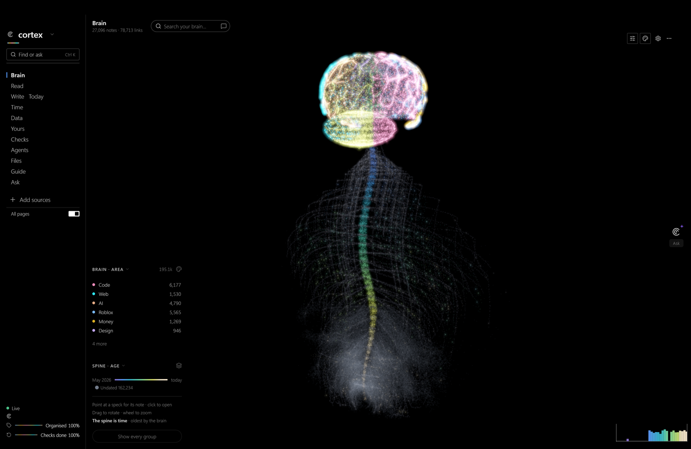
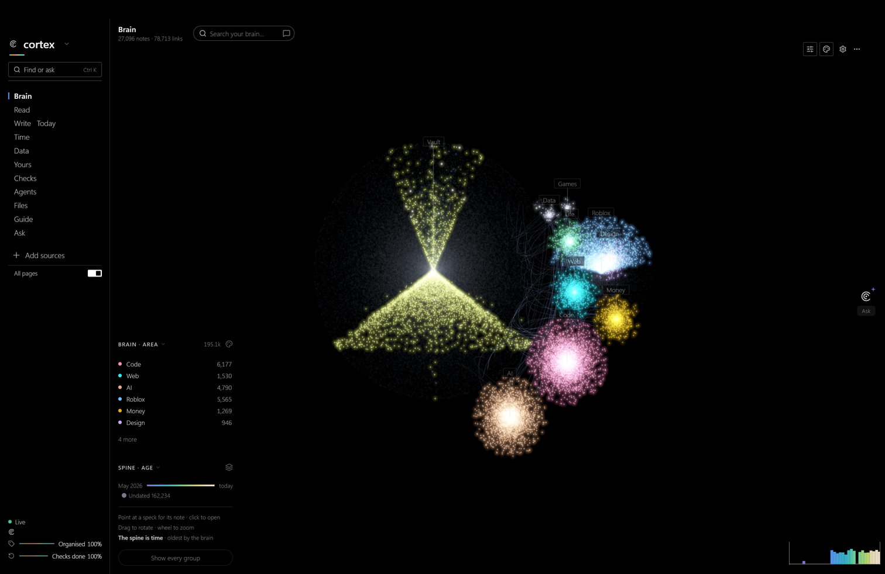
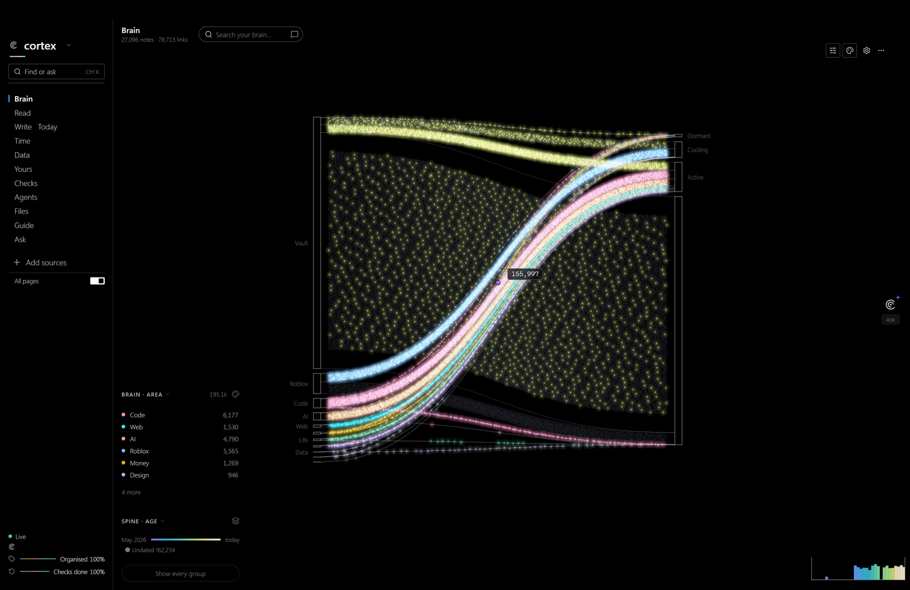
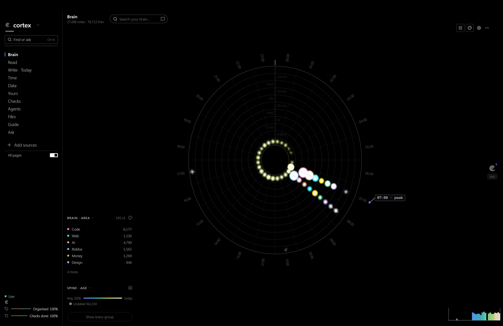
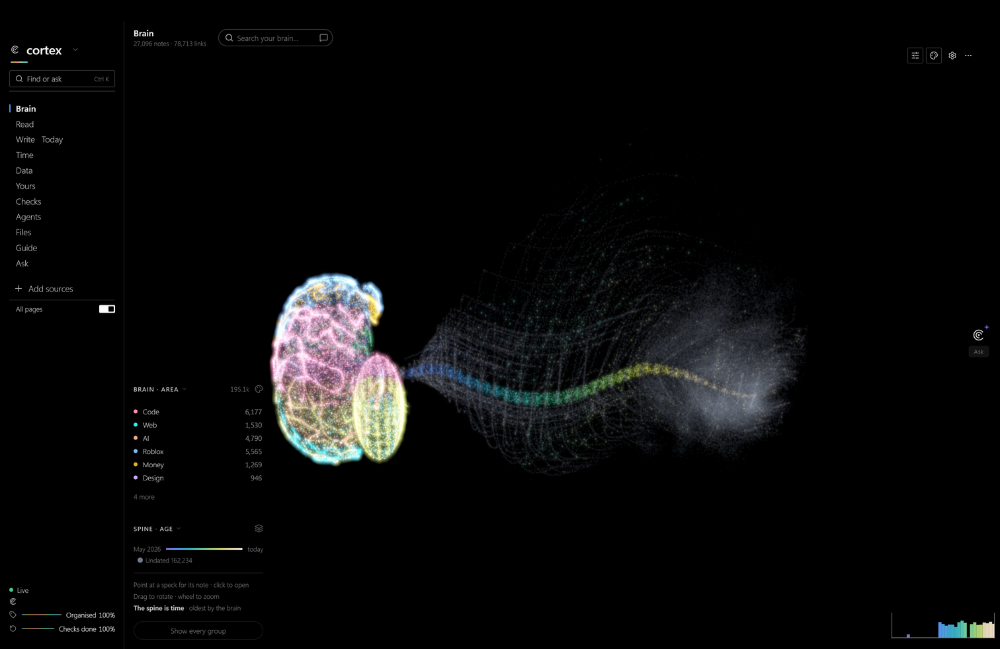
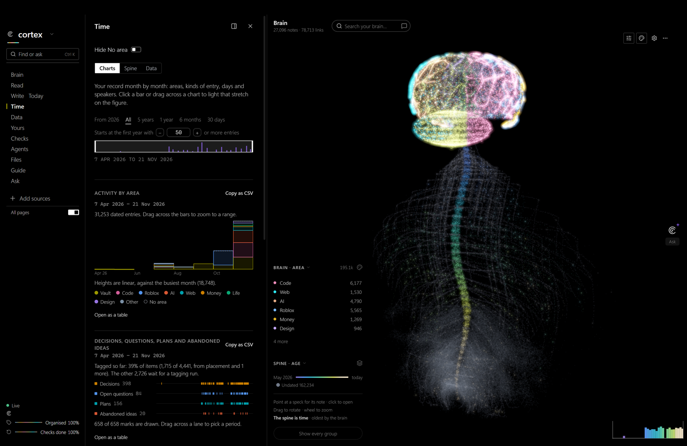
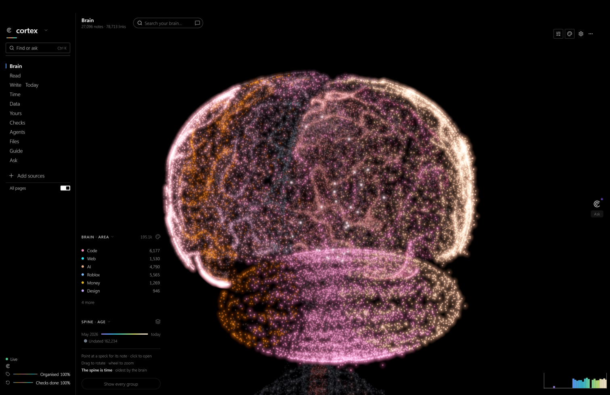

# Cortex

See everything you've written as one living 3D brain: your Obsidian notes, source documents and AI chats, sorted and summarised in the background.

Cortex Desktop on a real vault of about 27,000 notes. Every speck is one note or one message.

## What it does

- **Draws your whole record as a figure.** Notes sit in the brain, grouped by area. The spinal cord is time, oldest by the brain and newest at the bottom. Each conversation grows a nerve off the spine where it started.
- **Reads more than your vault.** Obsidian notes, documents in `.raw/`, Claude Code sessions, Claude.ai, ChatGPT and Gemini exports, folders you choose, and exports from WhatsApp, Telegram, Discord, Slack, Notion, Google Docs, Google Keep, Evernote, Roam, Kindle and Zoom. Codex CLI, Gemini CLI and Cursor sessions are opt-in.
- **Keeps your words as they are.** Cortex copies text into its own files and never rewrites or deletes your notes. Anything a model wrote is stored separately and always looks different (dotted rule, hollow marker), with a link back to the passage it came from.
- **Organises in the background.** Agents label conversations, write summaries and build maps of projects and topics, within limits you set. By default they stop at 70% of your Claude plan's 5-hour and weekly windows. Every decision lands in **Checks** where you confirm, change or reject it, and your answer wins.
- **Turns the same points into charts.** One slider moves every particle from the body into groups or into one of 20 charts: ranked bars, treemap, stream graph, calendar heatmap, radial clock, alluvial, chord and more.
- **Finds and asks from one bar.** Press Ctrl K to find anything. Press Tab to ask a question about your record. Answers quote your own entries, and every quote is checked against the text before it's shown.
- **Lets you undo everything.** Corrections, merges and exclusions are logged as changes with an Undo button. Nothing is ever deleted.

| | |
|---|---|
|  |  |
| **Groups:** the same notes pulled into labelled clouds, one per area. | **Flows:** a chart drawn with the figure's own particles, from each area to how recently it was active. |
|  |  |
| **Clock:** activity by hour of the day, one ring per area, with the peak hour marked. | **Side view:** the spine runs from oldest, by the brain, to newest. |
|  |  |
| **Time page:** monthly activity by area, and decisions, open questions, plans and abandoned ideas over time. | **Colour themes** recolour only the figure; the key keeps the area colours. |

## Download and install

Get both from the [latest release](https://github.com/A21-devs/cortex/releases/latest).

**Obsidian plugin** (Obsidian 1.12 or newer, desktop only)

1. Download `cortex-<version>.zip`.
2. Unzip it into your vault's `.obsidian/plugins/` folder. You should end up with `.obsidian/plugins/cortex/main.js`.
3. Reload Obsidian and open **Settings › Community plugins**. If it asks, choose **Turn on community plugins** first, then switch Cortex on.
4. Click the Cortex icon in the left ribbon (Open Cortex).

Cortex isn't in Obsidian's Community plugins browser yet, so updates are installed the same way: download the new zip and unzip it over the old folder. **Cortex: Check for updates** tells you when there is one.

**Cortex Desktop** (Windows 10 or 11, x64)

A standalone window that runs the same code outside Obsidian. Download `Cortex-Desktop-<version>-win-x64.zip`, unzip it anywhere and run `Cortex.exe`. It opens the `Obsidian Vault` folder in your Documents if that is a vault, and otherwise asks you to pick your vault folder.

The app isn't code-signed yet, so Windows SmartScreen may warn the first time. Click **More info › Run anyway**.

**For the agents and Ask** you need one of these:

- [Claude Code](https://claude.com/claude-code) installed and signed in (the default). Cortex runs it headless with no tools and stores no key.
- A model server on your own computer, such as Ollama or LM Studio (Settings › Agents).
- The Codex CLI, or an Anthropic API key.

Without any of them, Cortex still imports and draws everything. It just doesn't label or summarise.

## How it works

1. **First run.** Cortex shows what it would read, where the text goes and what models will see. Nothing is imported or sent until you press Start.
2. **Import.** A background process (`cortex-runner.js`) copies text from each source into `.raw/` in your vault as plain files, screens out secrets, and keeps watching Claude Code for new sessions.
3. **Organise.** Agents label, summarise and file conversations in the background, within your limits. Their output goes to `wiki/derived/`, marked as machine-written.
4. **Draw.** A layout worker places every entry and note on the figure, and the renderer draws it with three.js. The tab opens to a silhouette straight away and fills in as indexing finishes.

## Privacy

- **Your notes are never edited.** Cortex never rewrites or deletes existing notes, never runs git in your vault, and never touches other plugins' folders.
- **No internet requests on its own.** Cortex only goes online when you press a button for it, or for the weekly timestamp if you turn that on:
  - **Check for updates** sends one request to this repository's GitHub releases API.
  - **Timestamp publicly…** (optional, Settings › Advanced › Date seals) sends a hash of your newest seal block to the OpenTimestamps calendar at alice.btc.calendar.opentimestamps.org. **Check the timestamps** asks that calendar again and sends only a Bitcoin block number to blockstream.info. Weekly timestamps (off by default) send the same hash once a week. No text or names are sent.
- **You can see what models read.** **Cortex: Show what is sent** lists the text that goes to a model. The Access log on the Agents page records every model call and what it read.
- **Assistant replies from ChatGPT and Gemini are never sent to a model.** Only what you typed there is.
- **Some files are never read:** browser profiles, mail and password stores, `.env`, key and certificate files, `.ssh`, `.git` and `node_modules`, plus any folder you add in Settings › Privacy.
- **Lock.** **Cortex: Lock** (Ctrl+Shift+L) blanks every Cortex view. You can set a passphrase (stored as a salted PBKDF2 hash) and an idle auto-lock in Settings › Cortex › Privacy.

## FAQ

**Does it work on macOS or Linux?**
The plugin is desktop-only and is built and tested on Windows. Cortex Desktop is Windows only for now.

**Will it slow Obsidian down?**
Loading the plugin only registers its view and commands. Indexing runs in idle time, and the 3D part loads when you first open the Cortex tab. Imports run in a separate Node process when Node 20 or newer is installed, and inside Obsidian (slower) when it isn't.

**How much does organising cost?**
With Claude Code it runs on your existing Claude plan, nothing extra. By default the agents stop at 70% of the plan's 5-hour and weekly windows so you keep room for your own work, and the Agents page shows what was used and how much is waiting. A local model costs nothing.

**Can I try it without my own notes?**
Yes. Choose **Explore the sample record** on the empty Cortex tab, or **Sample record** in the More menu. Both use a made-up record and change nothing.

**Can I undo something an agent did?**
Yes. Every label, summary and filing is a check you can reject, and every change has Undo in Change history.

## Contributing

Bug reports and pull requests are welcome. Start with [CONTRIBUTING.md](CONTRIBUTING.md), then [docs/DEVELOPMENT.md](docs/DEVELOPMENT.md) for building from source, the project layout and the ground rules the checks enforce. Issues marked [good first issue](https://github.com/A21-devs/cortex/labels/good%20first%20issue) are small and self-contained.

## Credits

Built by me, with help from [Claude](https://claude.ai) (Anthropic) as a coding assistant. Bundles three.js and Preact (both MIT).

## License

[MIT](LICENSE)
